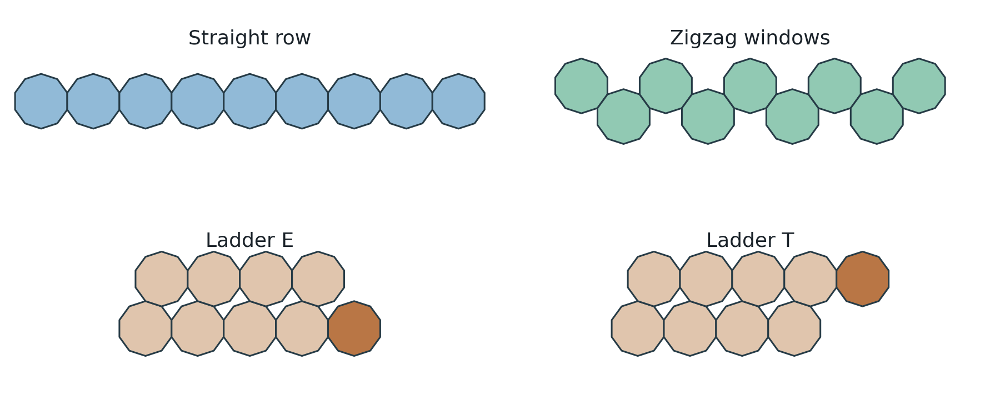

# Guaranteed self-assembly with permanent bonds

*Early research draft · v0.1*

Start with exactly $N$ identical regular polygons. Two independently formed bodies can join along a whole edge. The rule must work in every allowed order of encounters. The cells turn and translate. Finished shapes are compared up to rotation, translation and reflection.

## Results

| Question | Result |
| --- | --- |
| **Which target can we guarantee at one stock?** | An exact [catalogue criterion](proofs/fixed-target.md) characterizes every achievable target and every valid set of intermediates. At stock $2^k$, the target must split recursively into properly congruent halves. |
| **Can local communication match a rule that sees the entire body?** | Yes. A [frozen-label rule](proofs/power-completeness.md) with locally readable bond labels realizes the same exact catalogues at each fixed stock, using enough states and settling rounds. The simpler version with matching labels has a separate, open completeness question. |
| **What can one rule guarantee at every stock?** | At each stock all runs must give one shape. The [classification](proofs/all-stocks.md) gives rows, alternating zigzag windows and two-row ladders, with restrictions on the side count and angles. It covers all odd side counts and even side counts through 22. |
| **What does bounding communication change?** | A fixed [geometric observation radius](proofs/finite-radius.md) rules out every zigzag and ladder family. Rules that carry states across joins have a separate [settling cost](proofs/propagation.md), with bounds on how fast a new attachment can affect a distant edge. |
| **Can the same rule assemble and repair?** | A [repair criterion](proofs/repair.md) tests connected remnants larger than half the target. In the frozen-label model a two-round pulse can change the guaranteed repair of a four-cell square under the same subsequent injury. |

Straight rows and two-row ladders require even-sided cells. The two ladder variants differ in which row gets the extra cell at odd stock. At one designated stock the choices can be much wider. For example, eight squares can form a hollow ring by equal-size pairings even if the rule stalls at stock three.

## Examples and reproduction

- [Triangle and square atlas](atlas/README.md) for every target at stocks 1–10, with all inclusion-maximal sets of intermediates. Open [the atlas index](atlas/index.html) in a browser from a local clone to explore individual shapes.
- [Exact search records and commands](results/README.md) for the all-stock theorem, including certified checks for side counts 3–23 and the finite computation used for arbitrary odd side counts.
- [Common rules and geometry](proofs/rules.md) defines whole-edge joins, the three label observation models and the reduction from rules to geometry.

The open questions include the remaining even side counts, the completeness of matching tables, and sharp costs for rules that keep their states between joins. [All-side-count proof status](proofs/all-side-counts.md) · [Local model and open questions](proofs/power-completeness.md)
