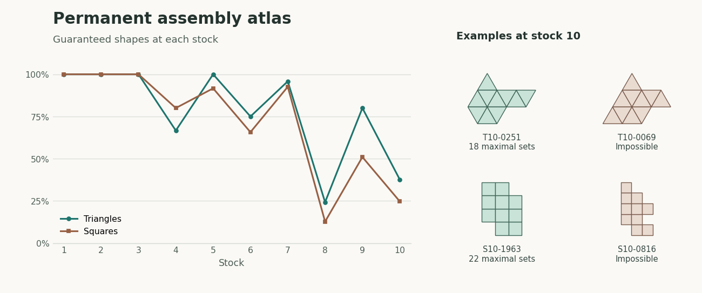

# Permanent assembly atlas for triangles and squares

The atlas exhausts every connected target through stock ten in the [fixed-stock model](../proofs/fixed-target.md). For each target it lists whether a rule can guarantee it and all inclusion-maximal valid factorizations. The [power theorem](../proofs/power-completeness.md) gives the same catalogue classification for frozen-label local rules with unrestricted state and settling at each fixed stock.

From a local clone, open [the combined index](index.html), [triangle atlas](triangles/index.html) or [square atlas](squares/index.html) in a browser. Each shape has a direct link, for example [the eight-square ring](squares/stock-08.html#S08-0198). Parts are linked to their own stock pages, where they can be treated as targets themselves.



## Counts

Targets are identified up to rotation, translation and reflection. Parts distinguish mirror hands when a rotation and translation cannot identify them. The counts of maximal sets below distinguish the mirror image of a whole catalogue when it is different.

| Stock | Triangle targets | Guaranteed | Maximal sets | Square targets | Guaranteed | Maximal sets |
|---:|---:|---:|---:|---:|---:|---:|
| 1 | 1 | 1 | 1 | 1 | 1 | 1 |
| 2 | 1 | 1 | 1 | 1 | 1 | 1 |
| 3 | 1 | 1 | 1 | 2 | 2 | 2 |
| 4 | 3 | 2 | 2 | 5 | 4 | 4 |
| 5 | 4 | 4 | 4 | 12 | 11 | 11 |
| 6 | 12 | 9 | 9 | 35 | 23 | 24 |
| 7 | 24 | 23 | 39 | 108 | 100 | 181 |
| 8 | 66 | 16 | 30 | 369 | 47 | 158 |
| 9 | 160 | 128 | 285 | 1,285 | 655 | 1,506 |
| 10 | 448 | 169 | 432 | 4,655 | 1,152 | 3,715 |
| Total | 720 | 354 | 804 | 6,473 | 1,996 | 5,603 |

## Method

The enumerator generates targets by adjoining one cell across a whole edge and identifying congruent shapes. A spanning tree of the contact graph gives a way to remove a leaf, so this enumerates every connected shape. All placements, symmetries and adjacency tests on the two lattices use integer coordinates.

For each target, enumerate connected subsets of both hands and the geometric joins obtained by splitting such subsets in two. Choose the parts of size at most half the stock. Independent replay justifies pruning choices whose parts cannot fit together into the target. Once the small parts are fixed, mark large parts in decreasing size by testing progress against every residual inventory of small parts. Keep only parts that can actually be built, then remove any resulting set contained in another. This is the [catalogue criterion](../proofs/fixed-target.md#the-catalogue-theorem), with the [majority-body test](../proofs/repair.md#remnants-larger-than-half-the-target) to avoid searching over all possible large parts.

## Reproduction

From the root, generate the JSON records, check every listed catalogue for validity, and render the pages. The verifier also checks reported maximality by direct enumeration on targets with at most twelve candidate parts.

```sh
python3 -B code/permanent_atlas.py --limit 10 --output atlas-data
python3 -B code/verify_permanent_atlas.py atlas-data
python3 -B code/render_permanent_atlas.py atlas-data atlas
```
