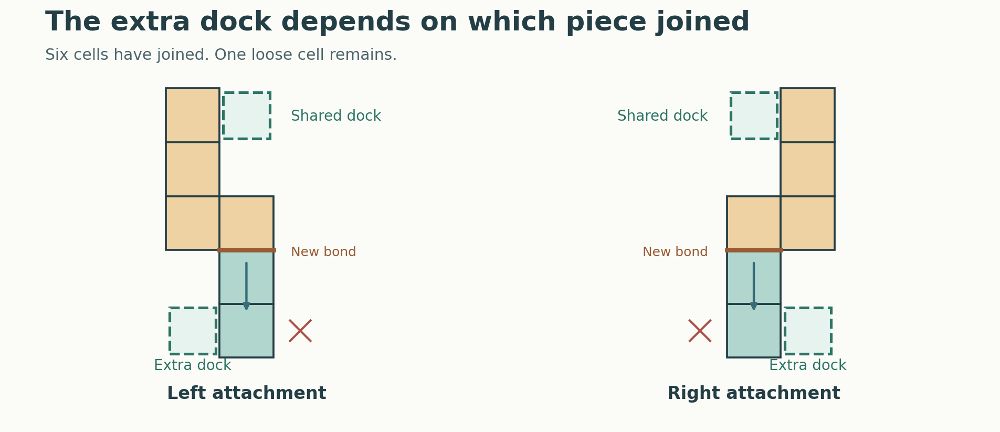

# Observation radius, states and settling rounds

A [bounded-radius geometric rule](finite-radius.md) computes each label from the current neighborhood of its edge. A [settled state rule](power-completeness.md) can retain information it received before a join. In the second model, the propagation cost of a join is the number of synchronous rounds it takes to settle, starting from the two settled input states. A catalogue can be compared by the worst delay before a further join or by an expected sum of delays under a specified encounter law. Encounter time also depends on how often the bodies meet in an allowed pose.

The radius theorem excludes the two nonlinear families for a uniform geometric radius. The corresponding all-stock question for a uniform number of rounds **with retained states** remains open.

## A full-view reference cost

Suppose each cell starts with the complete numbered placement of its old body. In each round it combines its retained view with the views sent by its bonded neighbors in the appropriate frames. For a join of $A$ and $B$, let $G_A,G_B$ be the old bond graphs and let $\partial_A,\partial_B$ be the cells incident to the new bonds in the two bodies. The exact number of rounds for every cell to learn the entire combined placement is

$$
1+\max\left\{\max_{v\in A} d_{G_A}(v,\partial_A),\;
             \max_{w\in B} d_{G_B}(w,\partial_B)\right\}.
$$

In the first round an endpoint on either side learns the entire other input from its new neighbor. The other cells learn it at one old bond per further round. Before that signal reaches a cell, all reports it receives contain only cells from its old body. A rule can settle sooner if its labels need less information than the entire placement.

## A lower bound for a required decision

**Proposition.** Fix the old states of a body $A$ and compare different attachments to it through the same $b$ new ports, with the same facing port numbers. Assume the cell input exposes no additional changing data at the interface beyond the new neighbors' states, or that any extra bond records agree across the comparison. Suppose a rule with $q$ states must settle within $r$ synchronous rounds and must distinguish $K$ responses at a set of ports whose cells are at least $d$ old bonds from the new interface. Then

$$
K\le q^{b\max(0,r-d)}.
$$

**Proof.** Once the incoming neighbor states at each new bond are fixed for each round, evolution on $A$ is determined by its common initial data. Only the first $\max(0,r-d)$ rounds of incoming messages can affect the tested ports by round $r$. They have at most $q^b$ possibilities per round. Evaluate every run at the same round, padding early-settled runs with fixed-point updates. ∎

For the pictured [seven-square target](../atlas/squares/stock-07.html#S07-0035), the old body is a vertical domino. The four-cell attachment adds either a left or a right arm at its upper end. A final singleton can dock at one shared upper position or at a side of the lower cell chosen by the arm. With the same old domino state, the lower cell cannot learn the arm in one round. A one-round rule that admits both histories must refuse both lower docks to retain the guarantee. Under unit-rate proposals and a uniform draw over the 12 collision-free poses, the shared dock alone gives a mean last wait of 12 time units, compared with 6 when both productive positions are enabled. This bounds the cost of retaining these docking options along both histories. Rules can also change the earlier joins.

## Encounter time from a fixed rule

Assign accepted placements independent exponential clocks at rates set by a specified encounter law and the allowed poses. At an inventory $x$, write $r_e(x)$ for the rate of a permitted event $e$, $y_e$ for its successor and $a(x)=\sum_e r_e(x)$ for the total. With settling instantaneous, the mean remaining wait satisfies

$$
E(x)=\frac{1}{a(x)}+\sum_e\frac{r_e(x)}{a(x)}E(y_e),\qquad E(T)=0.
$$

The first term is the mean time to the next accepted join. The second averages the remaining time over the possible joins. Each successor has one fewer body, so this is a backward calculation on inventories. For a rule with retained state, use settled states in the inventory and include the required settling delay in the cost of each successor if encounters pause during settling. The observable poses account for symmetry and alternative docking sites through their rates.
