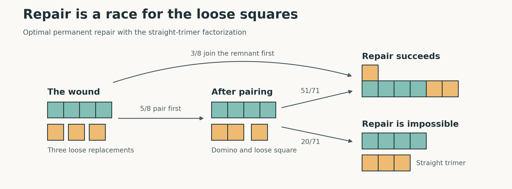
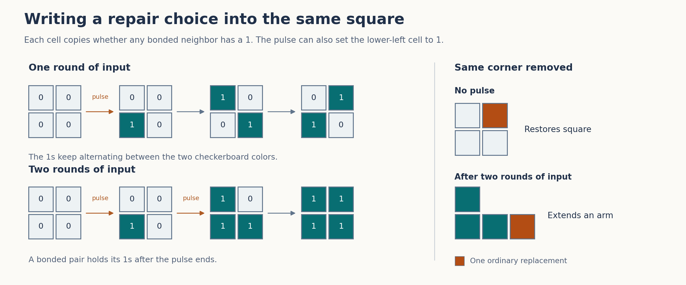

# Assembly, repair and temporary inputs

Start from a connected remnant of a target and supply ordinary loose cells to restore the original stock. Damage is an external deletion. All surviving bonds and all bonds formed during repair are permanent. Ask for the same rule to guarantee the target from loose cells and after the specified damage.

## Repair with two replacements

**Theorem.** Let $T$ be a guaranteed target of stock $N\ge4$. For any prescribed set of connected remnants after two cells are removed, a permanent whole-body rule can guarantee both assembly and repair of all those remnants if and only if each remnant can be completed by an intact domino.

**Proof.** A rule that succeeds from loose cells must enable a first singleton pair. The replacements can make the same pair before meeting the remnant. Any successful completion must then pack the remnant and domino intact. Conversely, take a successful blank whole-body rule. At each specified remnant, turn off its joins with a singleton and allow every remnant-plus-domino placement that finishes $T$. The removed join could only be used with that remnant and two loose cells present. The loose cells can still pair, and the resulting domino has a finishing join. All added joins finish the target, so ordinary assembly is still guaranteed. ∎

The necessity also holds for local states, since the ordinary replacement cells can pair independently. The [power theorem's implementation](power-completeness.md) can realize the sufficient rule locally, after reconstructing the input remnant and its bond records. For example, opposite corner vacancies of a $2\times m$ rectangle of squares, $m\ge3$, cannot be filled by an intact domino. The remaining body spans the same bounding box as the target, so any fit leaves nonadjacent vacancies.

## Remnants larger than half the target

Fix the types of size at most $N/2$ in a valid [catalogue](fixed-target.md#the-catalogue-theorem). Mark the full-stock hands of $T$. Scan larger-than-half connected subarrangements of either hand in decreasing size. Mark $A$ exactly when, for every inventory of the prescribed small types of mass $N-|A|$, either two of those small types can join within the small set or one can join $A$ to make an already marked type.

**Criterion.** A rule with the prescribed ordinary small types can guarantee ordinary assembly and repair of a connected majority remnant exactly when the remnant is marked. One rule repairs all marked remnants.

**Proof.** A reached majority body can be prepared with all material outside it left loose. In a repair history, replay its ancestry starting with the original remnant. Independently construct any residual inventory of the ordinary small types. Such replays must allow progress. A join of small bodies keeps mass below half and therefore gives an ordinary small type, since the operands can also be built from loose cells. A join involving the majority body gives a larger majority body. Decreasing induction proves necessity. For sufficiency, allow all geometric joins within the small set and the marked majority types. The test ensures progress in every inventory having a majority body. The progress condition in every full-stock inventory of small bodies follows from the original ordinary catalogue, whose majority types the same necessity argument marks. The small set stays exact because small parts have their original productions and a majority body never becomes small. ∎

For the [seven-square row with a foot](../atlas/squares/stock-07.html#S07-0002), a straight four is repairable when the remaining three squares can stay as singleton and domino. A catalogue that can produce a straight trimer allows the replacements to preassemble into a part that cannot pack with the remnant. Both catalogues guarantee the original target from loose cells.

### An exact repair probability

Keep the straight-trimer catalogue for ordinary assembly. Let each unordered pair of bodies propose at unit rate, drawing uniformly from its distinct collision-free full-edge placements. At the wound, a singleton can join the straight-four remnant productively in six of ten poses. The three loose pairs can also form dominoes at rate one per pair. The maximum probability that the first join productively attaches to the remnant is therefore $(3\cdot6/10)/(3+3\cdot6/10)=3/8$.

After a pair forms, the remnant can gain the singleton at rate at most $6/10$ or the domino at rate at most $6/24$. The replacement domino and singleton can make the straight trimer at rate $2/6$. The two straight placements are exchanged by a half-turn of the domino, so a blank whole-body rule that produces a straight trimer must allow both. The resulting three and four cannot repair together. The probability of a successful branch from this intermediate inventory is at most $(6/10+6/24)/(6/10+6/24+2/6)=51/71$.

Enabling every productive attachment attains both bounds. Each such attachment reaches a five- or six-cell body that already occurs in the ordinary catalogue, together with ordinary residual parts, so its continuation is guaranteed by replay. The straight-four remnant itself is absent from ordinary assembly, so these additional joins leave the ordinary guarantee and exact catalogue intact. The repair probability is $3/8+(5/8)(51/71)=117/142$, about $82.4\%$. [General probability calculation](fixed-target.md#possibility-guarantee-and-probability)

## A pulse that changes the next repair

Use the [frozen matching rule](power-completeness.md#simpler-binding-tables). Add a temporary Boolean input at one cell during updates. Hold the assembled body fixed during the input and subsequent settling. The control has input zero throughout. In both trials delete the same corner only after the intact body settles with no input, then let the remnant settle before any repair join.

**Proposition.** One rule guarantees the fully bonded $2\times2$ square from loose cells. A two-round synchronous pulse at one cell changes the guaranteed outcome after the same later corner deletion. The control restores the square, while the pulsed trial extends an arm of the remnant to give an L tetromino. The intact configurations agree in geometry, numbered ports, bonds and frozen labels.

**Ordinary assembly.** Loose squares have label $a$ on all sides, with $a$ paired to itself. The only other compatible pair is $s$–$t$. A domino keeps its $a$–$a$ bond. Each end cell labels its two free ports perpendicular to the bond by $s$ and $t$. Use $s$ when the direction from the end cell to its partner is a counterclockwise quarter turn from the free port's outward normal, and $t$ for a clockwise quarter turn. Its longitudinal free port is inert. Only singleton pairs and domino pairs can join. The complementary side labels align the two dominoes into a square and both contacts across the seam bond. All free labels on the intact square are inert.

**Writing and reading.** Every cell starts with a bit $z_v=0$. Update $z_v$ to the OR of the temporary input at $v$ and all bonded neighbors' old bits. In round one the pulsed cell becomes 1. In round two it stays 1 and its neighbors also become 1. After the input ends, the two ends of any activated bond hold their bits under every update order. The signal spreads from that pair, so fairness fills the square. After the wound the three surviving cells each have a surviving neighbor and keep their values.

In the L-shaped remnant, the elbow has one original $a$–$a$ bond and one later $s$–$t$ bond. The tip at the original bond uses the elbow's reported bond directions and bit. When the bit is zero it shows $a$ toward the vacancy. When it is one it shows $a$ at the end of the original domino. Every other free edge of the remnant is inert. There is one placement of the ordinary replacement in each mode, up to its own orientation. The square outcome refers to geometry. The restored corner may have an unbonded contact.

The geometric part of this rule uses immediate bond reports. A cell knows its incident labels by recovering the partners of the facing labels. A tip's label then depends on its bonded neighbor's report. Both layers stabilize under fair updates, and the bit stabilizes by the same argument whether or not the replacement has already joined.

**Why duration matters.** For any neighbor-only update on a fixed bipartite bond graph, start from a settled control and pulse one cell for one synchronous round. At withdrawal, only the pulsed cell's state can differ from the control. Each subsequent synchronous round moves the possible differences to the other side of the bipartition, since a cell on the old side reads only control states. Thus a distinct settled fixed point is impossible. If reading one's own state is allowed, add $z_v$ itself to the OR and a single pulse round suffices.

**Survival bound.** With the two-round preparation on a connected body with at least one bond, a component retains the bit after deletion if it contains a surviving bond. Each isolated cell settles to the common output on empty input. Hence some trace of the pulse survives every deletion of up to $k$ cells exactly when $k$ is smaller than the minimum number of cells meeting every bond. That number is the vertex-cover size of the bond graph. This concerns the distinction detectable before repair joins. Geometric feasibility still determines what repairs can use it.
